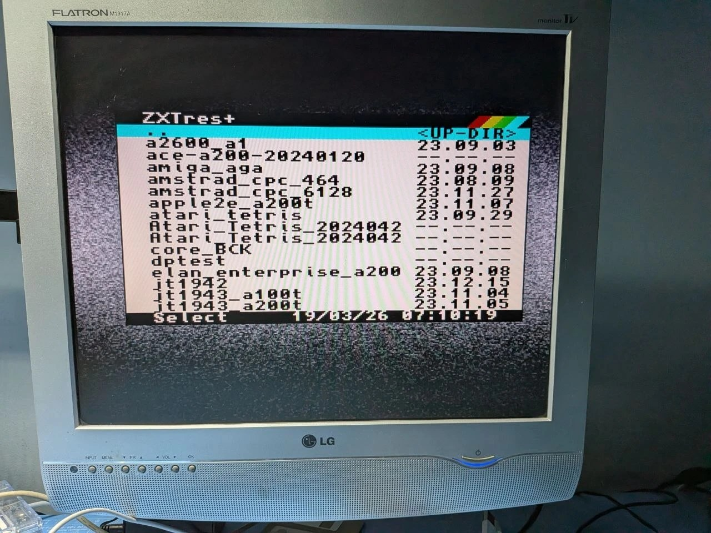

# MiST firmware for the ZXTRES middle board (RP2040), with the ZX Spectrum theme

This is a fork of [ZXMicroJack/mist-firmware-rp2040](https://github.com/ZXMicroJack/mist-firmware-rp2040),
the MiST firmware for the RP2040 middle board of the ZXTRES family. This fork
adds the **ZX Spectrum theme** of the core menu and of the OSD.

*The core menu of a ZXTRES+ with the theme: the Spectrum-coloured title bar,
the file list with the date of each entry, and the status bar with the clock.*

## What the theme changes

- An opaque OSD in Spectrum colours, with a title bar and a status bar.
- A clock in the status bar.
- A centred *About* page.
- A file selector in the style of the MiSTer one, with the date of each entry
  taken from its name.

## The repositories of this improvement

The theme is split in four repositories: the firmware, the menu core, and the
two submodules each one builds on. The work is in the branch `zxtres-theme` of
the submodules.

| Repository | What it holds |
| --- | --- |
| [mist-firmware-rp2040](https://github.com/aitorgomez-net/mist-firmware-rp2040) (this one) | The firmware build, and the builds of the theme in `release-local` |
| [mist-firmware](https://github.com/aitorgomez-net/mist-firmware) | The firmware source (submodule): the file selector, the clock and the *About* page. Branch `zxtres-theme` |
| [mist-ports](https://github.com/aitorgomez-net/mist-ports) | The menu core for the ZXTRES boards, with the themed OSD in Verilog (`menu/zxtres/osd_zx.v`) |
| [Menu_MIST](https://github.com/aitorgomez-net/Menu_MIST) | The generic menu core (submodule of mist-ports) with the hooks for the theme. Branch `zxtres-theme` |

## Builds

The builds of the version 2.18 with the theme are in `release-local`:

| Folder | Content |
| --- | --- |
| `v2.18-zxtheme-mb1` | Firmware for the middle board MB1 (`.uf2`) and the menu core for the A100T (`core-a100t-zxtheme2.bit`) |
| `v2.18-zxtheme2` | Firmware for the middle board MB2 (`RP2MAPP.BIN` and `rp2m-signed.uf2`) |

The history of the firmware versions is in [changelog.txt](changelog.txt).

## Cores that use the middle board

The `.BIT` file of a core can go in the `MIST` folder of the card, and this
menu lists it by its file name. See for example the
[PCXT](https://github.com/aitorgomez-net/PCXT_ZXTres) and
[PCAT-286](https://github.com/aitorgomez-net/PCAT-286_ZXTres) ports for the
ZXTRES+ and ZXTRES++.
